<div align="center">



<br>

[](https://www.linkedin.com/in/alfez-tintoiya/)
[](mailto:alfez.tintoiya25@gmail.com)
[](https://leetcode.com/u/alfez18/)

**I build software that turns complex problems into dependable systems.**

</div>

---

## `GET /alfez`

> What would this profile return if it were an API? Here is the response.

```json
{
  "name": "Alfez Tintoiya",
  "status": "operational",
  "role": "AI Engineer @ Solvay5 (remote)",
  "education": "B.Tech, Computer Engineering — PDEU, Gandhinagar (2026)",
  "building": [
    "AI agents that verify and enrich research data",
    "async, idempotent pipelines for long-running work",
    "platform features: notifications, feedback, source attribution, live query progress"
  ],
  "cares_about": ["failure handling", "data consistency", "maintainability"],
  "learning_next": ["system design at scale", "AI infrastructure", "agent evaluation"],
  "open_to": ["relocation", "hard backend problems", "interesting AI systems"],
  "latency_to_reply": "low"
}
```

---

## Release history

| Version | Where | When | What shipped |
|:--|:--|:--|:--|
| **v3.0** `current` | AI Engineer · **Solvay5** | Jul 2026 – now | Security, collaboration, notifications, entity feedback, field-level source attribution, real-time query progress. Backend data evolution through migrations and indexing. PydanticAI + SerpAPI agents that verify researcher identities and enrich profiles with metrics and publications. |
| **v2.0** | AI Engineer Intern · **Solvay5** | Jan – Jun 2026 | Async, idempotent AI research pipelines on FastAPI and MongoDB. Multi-agent workflows with Claude, Gemini and MCP-based web search, using callback execution and careful state management. Indexing, telemetry and pipeline optimization. |
| **v1.0** | Software Engineer Intern · **Rebel Minds** | May – Jul 2025 | Node.js/Express microservices: API latency down **25%** (400 ms → 300 ms) via query and connection-pool tuning. MCP servers orchestrating **10+ AI agents** for parallel inference, deployed with Docker, health checks and retries. |

---

## Dependency manifest

```python
# stack.py — what I reach for

languages       = ["Python", "C++", "JavaScript", "TypeScript", "Java", "SQL"]
backend         = ["FastAPI", "Node.js", "Express.js", "REST APIs"]
frontend        = ["React", "Next.js", "HTML", "CSS"]
data            = ["PostgreSQL", "MongoDB", "MySQL", "Supabase", "Firebase"]
ai_and_agents   = ["PydanticAI", "MCP", "Claude", "Gemini", "SerpAPI"]
infrastructure  = ["Docker", "AWS", "Linux", "Git", "GitHub"]
foundations     = ["DSA", "DBMS", "Operating Systems", "Computer Networks", "OOP"]
```

<div align="center">
  
</div>

---

## Selected projects

<table>
<tr>
<td width="50%" valign="top">

### VirtualHire
**Remote interview platform**

Real-time video interviews with a collaborative code editor, built for the moment when two people need to think out loud together.

- WebRTC peer-to-peer video calling
- Monaco-based code editor synced over WebSockets
- JWT authentication

`MERN` · `WebRTC` · `WebSockets`

</td>
<td width="50%" valign="top">

### Resumind
**AI resume analyzer**

Resume feedback that tells you what to change, not just what is wrong.

- Section-wise evaluation and ATS optimization
- Role-specific recommendations via Gemini
- Google OAuth, cloud PDF processing, live progress tracking

`MERN` · `PostgreSQL` · `Gemini API` · `Supabase`

</td>
</tr>
</table>

More in my [repositories](https://github.com/alfeztintoiya?tab=repositories).

---

## Benchmarks

Competitive programming is where I practise breaking a hard problem down, reasoning about constraints, and finding a solution that is both correct and efficient. **1,000+ problems solved.**

| Platform | Handle | Result |
|:--|:--|:--|
| LeetCode | [alfez18](https://leetcode.com/u/alfez18/) | **2011 · Knight · Top 3% worldwide** |
| Codeforces | [alfez2503](https://codeforces.com/profile/alfez2503) | **1426 · Specialist** |
| CodeChef | [alfez18](https://www.codechef.com/users/alfez18) | **1713 · 3★** |
| Meta Hacker Cup 2025 | — | **Rank 1774 · Round 2** |

---

## Roadmap

- [x] Ship AI-agent pipelines that hold up in production
- [x] Move from intern to full-time AI Engineer
- [ ] Go deeper on system design and distributed systems
- [ ] Learn how to evaluate agents properly, not just demo them
- [ ] Build more AI infrastructure
- [ ] Keep climbing the leaderboards

---

<details>
<summary><b>Runbook: how to work with me</b></summary>

<br>

- **Best for:** backend and AI-agent problems where reliability matters more than the demo.
- **Fastest channel:** email, [alfez.tintoiya25@gmail.com](mailto:alfez.tintoiya25@gmail.com).
- **Good topics:** multi-agent orchestration, MCP, async pipelines, database design, algorithms.
- **Location:** Gujarat, India. Remote-friendly and open to relocating for the right opportunity.

</details>

<br>

<div align="center">

**On-call:** [LinkedIn](https://www.linkedin.com/in/alfez-tintoiya/) · [Email](mailto:alfez.tintoiya25@gmail.com) · [GitHub](https://github.com/alfeztintoiya)

<sub>Build thoughtfully. Make it reliable. Keep learning.</sub>

</div>
