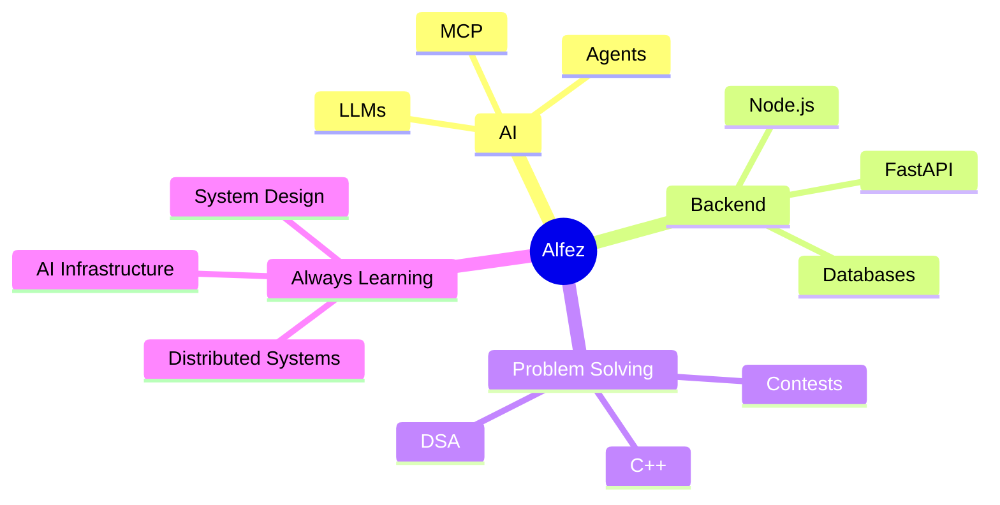

<div align="center">


<br>

[](https://www.linkedin.com/in/alfez-tintoiya/)
[](mailto:alfez.tintoiya25@gmail.com)
[](https://leetcode.com/u/alfez18/)
[](https://codeforces.com/profile/alfez2503)

### I build software that turns complex problems into dependable systems.

</div>

---

## `$ whoami`

```python
class Alfez:
    role      = "AI Engineer"
    superpower = "turning messy problems into clean, reliable systems"
    fuel      = ["algorithms", "AI agents", "backend architecture", "good coffee"]
    mindset   = "make it work, then make it dependable"

    def currently(self):
        return "building with AI agents and shipping things that don't break"

    def always(self):
        yield from ["learning", "solving", "building"]
```

---

## What lives in my head



---

## Toolbox

<div align="center">
  
</div>

<br>

<div align="center">

| | |
|:--|:--|
| **Languages** | Python · C++ · JavaScript · TypeScript · Java · SQL |
| **Backend** | FastAPI · Node.js · Express |
| **Frontend** | React · Next.js |
| **Data** | PostgreSQL · MongoDB · MySQL · Supabase · Firebase |
| **AI** | MCP · Claude · Gemini · PydanticAI |
| **Infra** | Docker · AWS · Linux · Git |

</div>

---

## Things I've built

<table>
<tr>
<td width="50%" valign="top">

### 🎥 VirtualHire
*Remote interviews, minus the awkward tools.*

Live video calls and a shared code editor in one place, so two people can solve a problem together in real time.

`MERN` · `WebRTC` · `WebSockets` · `JWT`

</td>
<td width="50%" valign="top">

### 📄 Resumind
*Resume feedback you can actually act on.*

An AI analyzer that scores each section, checks ATS-friendliness and suggests role-specific improvements.

`MERN` · `PostgreSQL` · `Gemini` · `Supabase`

</td>
</tr>
</table>

<div align="center">

[**→ Browse all repositories**](https://github.com/alfeztintoiya?tab=repositories)

</div>

---

## The leaderboard

```text
┌──────────────────────┬────────────┬──────────────────────────┐
│ ARENA                │ HANDLE     │ RANK                     │
├──────────────────────┼────────────┼──────────────────────────┤
│ LeetCode             │ alfez18    │ 2011 · Knight · Top 3%   │
│ Codeforces           │ alfez2503  │ 1426 · Specialist        │
│ CodeChef             │ alfez18    │ 1713 · 3★                │
│ Meta Hacker Cup 2025 │ —          │ Round 2 · Rank 1774      │
└──────────────────────┴────────────┴──────────────────────────┘
                 1,000+ problems solved and counting
```

---

## Quest log

- [x] Solve 1,000+ algorithmic problems
- [x] Reach Knight on LeetCode
- [x] Graduate and start working as an AI Engineer
- [ ] Master system design
- [ ] Build serious AI infrastructure
- [ ] Reach Candidate Master on Codeforces

---

## Let's talk

If you're working on something interesting in **AI, backend or algorithms**, I'd like to hear about it.

<div align="center">

[](https://www.linkedin.com/in/alfez-tintoiya/)
[](mailto:alfez.tintoiya25@gmail.com)
[](https://github.com/alfeztintoiya)

<br>

<sub>Build thoughtfully. Make it reliable. Keep learning.</sub>

</div>
